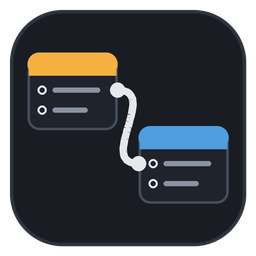
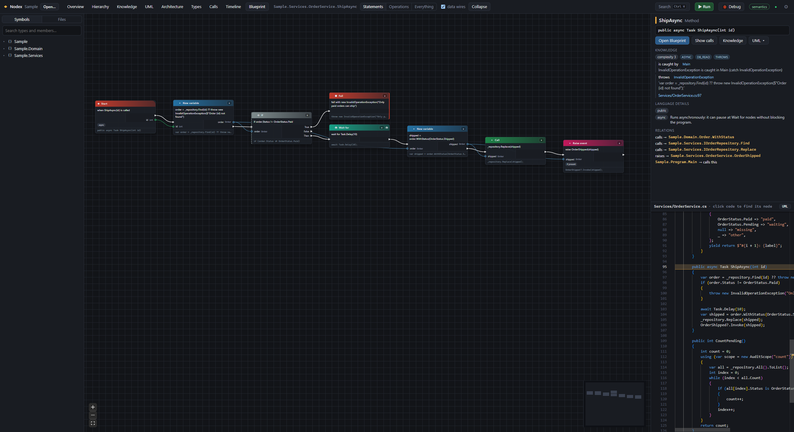
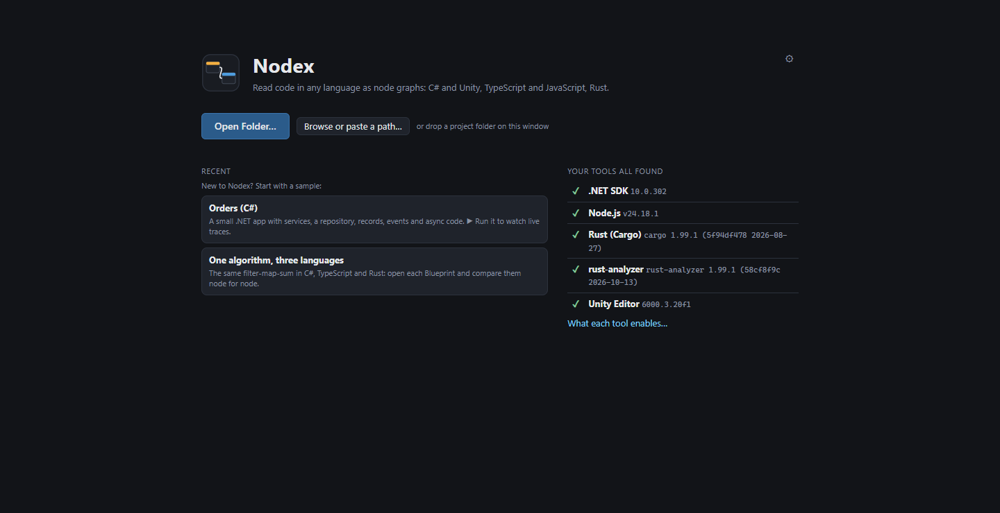
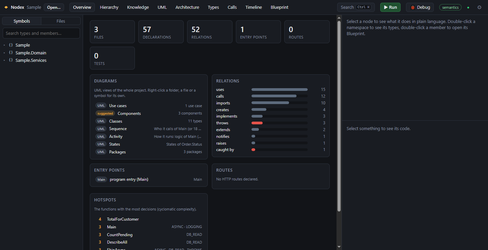
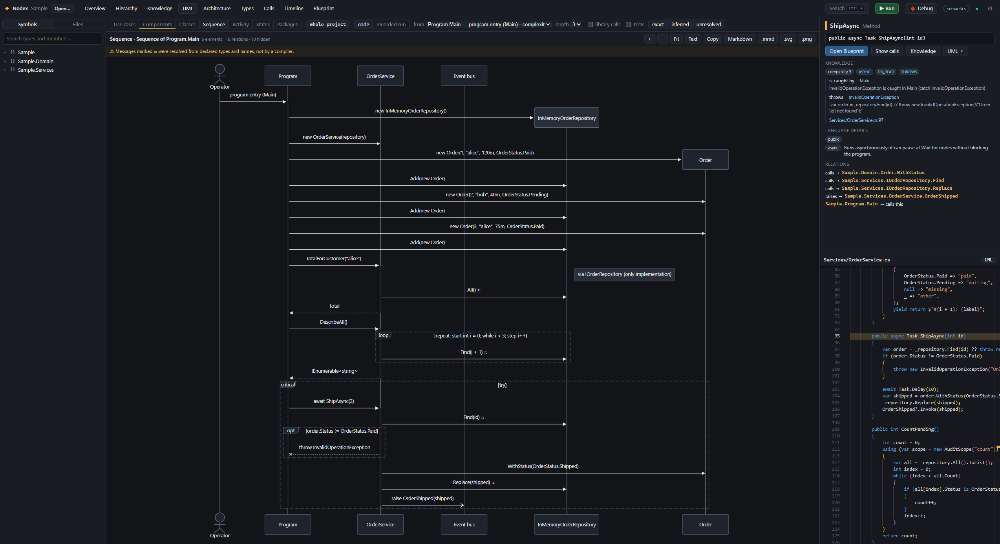
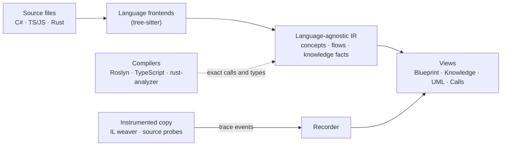

<div align="center">



# Nodex

**Read code in any language as node graphs.**

Nodex turns C#, Unity, TypeScript/JavaScript and Rust projects into language-agnostic,<br>
Blueprint-style node graphs, UML diagrams and live execution traces.

[](https://github.com/LeGustaVinho/nodex/actions/workflows/ci.yml)
[](https://github.com/LeGustaVinho/nodex/releases/latest)
[](LICENSE)
[](#install)

[**Download**](https://github.com/LeGustaVinho/nodex/releases/latest) ·
[Guide](docs/guide.md) ·
[Build from source](docs/development.md) ·
[Changelog](CHANGELOG.md)

<br>



</div>

<br>

## Contents

- [Why Nodex](#why-nodex)
- [Features](#features)
- [Language support](#language-support)
- [Install](#install)
- [Quick start](#quick-start)
- [How it works](#how-it-works)
- [Privacy and security](#privacy-and-security)
- [Roadmap](#roadmap)
- [FAQ](#faq)
- [Contributing](#contributing)
- [License](#license)

## Why Nodex

Opening a project in a language you don't speak is slow: the syntax, the idioms and the frameworks all get in the way of the one question you have, *what does this code do?*

Nodex answers it with a single visual vocabulary. Each language is lowered to the same set of concepts, so the same logic looks the same everywhere:

<table>
<tr>
<th>C#</th>
<th>TypeScript</th>
<th>Rust</th>
</tr>
<tr>
<td>

```csharp
foreach (var o in orders)
    total += o.Amount;
```

</td>
<td>

```ts
for (const o of orders)
  total += o.amount;
```

</td>
<td>

```rust
for o in &orders {
    total += o.amount;
}
```

</td>
</tr>
<tr>
<td colspan="3" align="center">all three are one <b>For Each</b> node with a <b>Set</b> node inside it</td>
</tr>
</table>

Above the functions, Nodex reads what a compiler alone doesn't show. That covers which front-end calls reach which HTTP route, what dependency injection wires together, which tests cover a symbol, and where an exception is caught. It can also run the program and light up the graph as it executes.

## Features

**Understand the structure**
- **Overview**: entry points (program, HTTP routes, commands, jobs, message consumers, UI), hotspots by cyclomatic complexity, data models, tests, unresolved relations and state machines, each as a full list you can filter.
- **Hierarchy**: folders, namespaces, types and members as boxes that open in place, with their relations rolled up.
- **Explore**: select a node to light up its relations (or show only those, in or out), filter by relation, confidence and third-party code, pick a layout (layers from the focus, force-directed, concentric…), group nodes in class, file or namespace boxes, and hover anything for its evidence.
- **Architecture**, **Types** and **Calls**: namespaces and packages, inheritance and use, callers and callees (including events and their handlers).

**Read a function**
- **Blueprint**: the statements of one function as nodes, with exec wires, data wires for variables and plain-language labels.
- **Inspector**: explains the concept behind each node and what each language calls it. For a symbol: its evidence, full-stack and error flows, data fields, impact radius and tests.
- **Two-way sync**: click the code to find its node, click a node to see its code.

**Follow the system**
- **Knowledge graph**: HTTP calls from front end to back end, dependency injection, tests, thrown and caught exceptions, data writes and authorization. Relations no compiler proves are marked *inferred* or *unresolved*.
- **UML**: use case, component, class, sequence, activity, state and package diagrams of the project, a folder, a file or a symbol. Export them as Mermaid, Markdown, SVG or PNG.

**Watch it run**
- **▶ Run**: builds an instrumented copy of the program and runs it. Nodes count executions, show the values they produce and glow while they run.
- **Timeline and Replay**: every call as a flame chart, and any call replayed step by step.
- **Debug**: breakpoints and stepping through the Debug Adapter Protocol, shown in the code and in the graph.

**Feels like a desktop app**
- One installer with no administrator rights, plus automatic signed updates.
- A native menu, folder picker and Save dialog, drag and drop, and "Open with Nodex" in Explorer.
- Sample projects and a check of the installed toolchains on the welcome screen.

<table>
<tr>
<td width="50%"></td>
<td width="50%"></td>
</tr>
<tr>
<td align="center"><sub>Welcome screen: samples, recent folders, installed tools</sub></td>
<td align="center"><sub>Overview: what the project is at a glance</sub></td>
</tr>
<tr>
<td colspan="2"></td>
</tr>
<tr>
<td colspan="2" align="center"><sub>A sequence diagram generated from the code, with loop, critical and opt fragments</sub></td>
</tr>
</table>

## Language support

Every language gets the structure, Blueprints, the knowledge graph and UML from the syntax alone. Its toolchain adds exact semantics, Run and Debug.

| | C# (.NET) | Unity | TypeScript / JavaScript | Rust |
| :--- | :---: | :---: | :---: | :---: |
| Structure, Blueprints, UML | ✓ | ✓ | ✓ | ✓ |
| Exact semantics | ✓ Roslyn | ✓ Roslyn | ✓ TypeScript compiler | ✓ rust-analyzer |
| ▶ Run with live traces | ✓ | ✓ Play Mode | ✓ Node and browser apps | ✓ |
| Debug | ✓ netcoredbg | ✓ Unity debugger | ✓ js-debug | ✓ CodeLLDB |
| Needs | [.NET SDK 10+](https://dotnet.microsoft.com/download) | [Unity 2021.3+](https://unity.com/download) | [Node.js](https://nodejs.org/en/download) | [rustup](https://rustup.rs) + `rust-analyzer` |

The knowledge graph recognizes common frameworks:

- **C#**: ASP.NET Core controllers and minimal APIs, `[Authorize]`, Entity Framework `DbSet`, `AddScoped`/`AddSingleton`/`AddTransient`, xUnit, NUnit and MSTest, `BackgroundService`, Quartz jobs, message consumers, Stateless and Unity Animator.
- **TypeScript / JavaScript**: Express, Fastify, Next.js, decorator-based controllers, Prisma and TypeORM, `fetch` and axios, Jest/Vitest-style tests, React components and `useState`, XState.
- **Rust**: axum, actix-web and Rocket routes (with `nest`, `scope` and `mount`), Diesel and SeaORM, reqwest, `#[test]`.

## Install

1. Download `Nodex_<version>_x64-setup.exe` from the [latest release](https://github.com/LeGustaVinho/nodex/releases/latest).
2. Run it. It installs for your user only (in `%LOCALAPPDATA%\Nodex`), without administrator rights.
3. Nodex checks for updates when it starts and asks before installing one. You can turn this off in Settings.

> [!NOTE]
> The installer is not code-signed yet, so Windows SmartScreen may say it "protected your PC". Choose **More info → Run anyway**.

Debug adapters are downloaded on demand, the first time you debug a language, and checked against a pinned SHA-256 hash.

## Quick start

1. **Open a project.** Use **Open Folder…** on the welcome screen, drop a folder on the window, or right-click a folder in Explorer and choose **Open with Nodex**. To look around first, pick a sample.
2. **Find your way.** Start at **Overview**. Press <kbd>Ctrl</kbd>+<kbd>K</kbd> to search any symbol or view, and double-click a member to open its **Blueprint**.
3. **Run it.** Press **▶ Run** and watch the graphs light up. Then open **Timeline** and double-click a call to replay it.

The [guide](docs/guide.md) covers every view, the UML diagrams, Run and debugging, settings and troubleshooting.

## How it works



- **Frontends** parse each file with tree-sitter and lower it to a shared intermediate representation. Statements become concepts from one catalog, so `foreach`, `for..of` and `for in` all become *For Each*.
- **Sidecars** run each language's own compiler in the background and add exact facts to the graphs: Roslyn for C#, the TypeScript compiler API, and rust-analyzer's SCIP index.
- **Run** builds an instrumented copy of the program. .NET is IL-woven, and JavaScript, TypeScript and Rust are rewritten at the source level. The copy streams trace events back over a local socket, and the recorder maps them onto the graphs, the Timeline and the diagrams.
- The **desktop app** is a [Tauri](https://tauri.app) shell around a local Rust server, which serves a React UI built on React Flow, ELK, Monaco and Mermaid.

[docs/development.md](docs/development.md) maps each part to its place in the repository.

## Privacy and security

- **Your code stays on your computer.** Nodex reads it locally and never uploads it. It goes online only to check for updates and to download a debug adapter you install.
- **The local server is locked down.** It listens on `127.0.0.1` only, needs a random session token for every request, and rejects foreign `Host` and `Origin` headers.
- **Updates are signed.** The app refuses an update whose signature does not match the key built into it.

Please report vulnerabilities privately; see [SECURITY.md](SECURITY.md).

## Roadmap

- [x] C#, Unity, TypeScript/JavaScript and Rust: graphs, semantics, Run and Debug
- [x] Knowledge graph and the seven UML diagrams
- [x] Windows desktop app with installer and automatic updates
- [ ] Code-signed installer
- [ ] `winget` package
- [ ] macOS and Linux builds

See [CHANGELOG.md](CHANGELOG.md) for what each release brings.

## FAQ

<details>
<summary><b>Does Nodex change my code?</b></summary>

No. Nodex reads your files and keeps its own state (layouts, breakpoints, run output) in a `.nodex` folder in the project, which you can add to `.gitignore`. ▶ Run builds and runs an instrumented *copy*. For Unity, the Nodex package is added to `Packages/` only when you click **Install** on the Unity card, and its probes are woven into the compiled assemblies, not into your scripts.
</details>

<details>
<summary><b>Do I need the toolchains installed?</b></summary>

No, not to read code: structure, Blueprints, the knowledge graph and UML all work from the syntax. A toolchain makes calls and types exact and enables Run and Debug for its language. The badge at the top right (**semantics** or **syntax only**) shows which you have; click it to see what is missing.
</details>

<details>
<summary><b>Does it work offline?</b></summary>

Yes. Only the update check and the first download of a debug adapter need the internet.
</details>

<details>
<summary><b>How big a project can it open?</b></summary>

Files are parsed in parallel and each graph is built when you open it, so large solutions stay responsive. Build output and dependencies (`bin`, `obj`, `node_modules`, `target`, Unity's `Library`) are skipped, and so are files over 2 MB, which are usually generated or minified.
</details>

<details>
<summary><b>Where does Nodex keep its data, and how do I remove it?</b></summary>

- Settings and recent folders: `%APPDATA%\io.github.legustavinho.nodex`.
- Logs, debug adapters and sample copies: `%LOCALAPPDATA%\io.github.legustavinho.nodex`.

Uninstall from Windows Settings and tick **Delete the application data** to remove both.
</details>

<details>
<summary><b>Is there a command line?</b></summary>

Yes. Developers can run `nodex open <folder>` to serve the same UI in a browser; see [docs/development.md](docs/development.md).
</details>

## Contributing

Bug reports, ideas and pull requests are welcome. Read [CONTRIBUTING.md](CONTRIBUTING.md) for how to report a problem and what a pull request needs. Read [docs/development.md](docs/development.md) to build Nodex from source, run the tests and make the installer.

## License

Nodex is released under the [MIT License](LICENSE).

It is built on [Tauri](https://tauri.app), [tree-sitter](https://tree-sitter.github.io), [Roslyn](https://github.com/dotnet/roslyn), the [TypeScript](https://www.typescriptlang.org) compiler, [rust-analyzer](https://rust-analyzer.github.io), [Mono.Cecil](https://github.com/jbevain/cecil), [React Flow](https://reactflow.dev), [ELK](https://eclipse.dev/elk/), [Monaco](https://microsoft.github.io/monaco-editor/) and [Mermaid](https://mermaid.js.org), among others. Their licenses ship with the app under Help → Third-Party Licenses.
