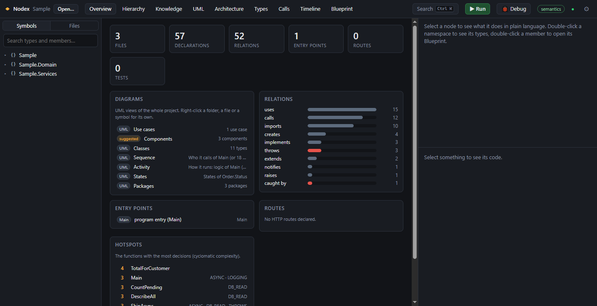
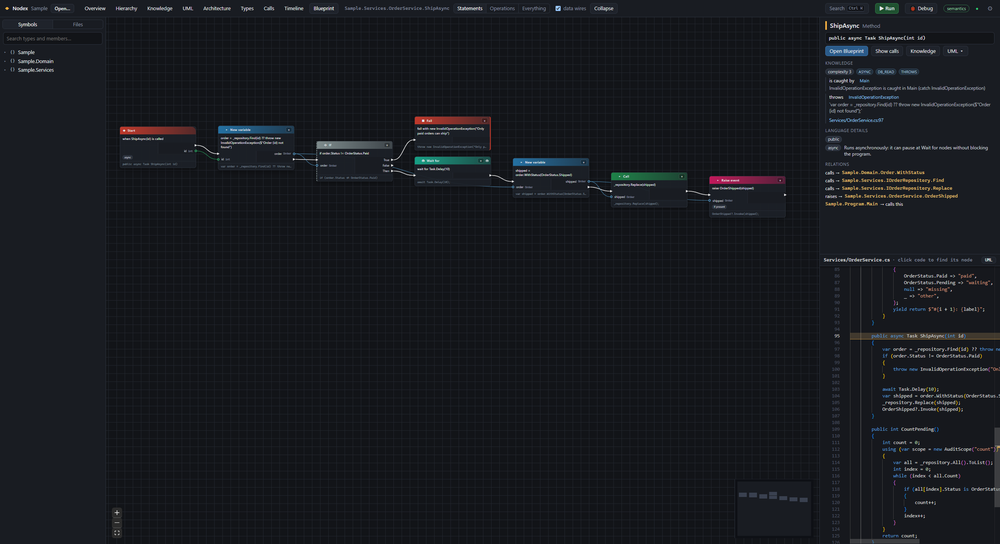
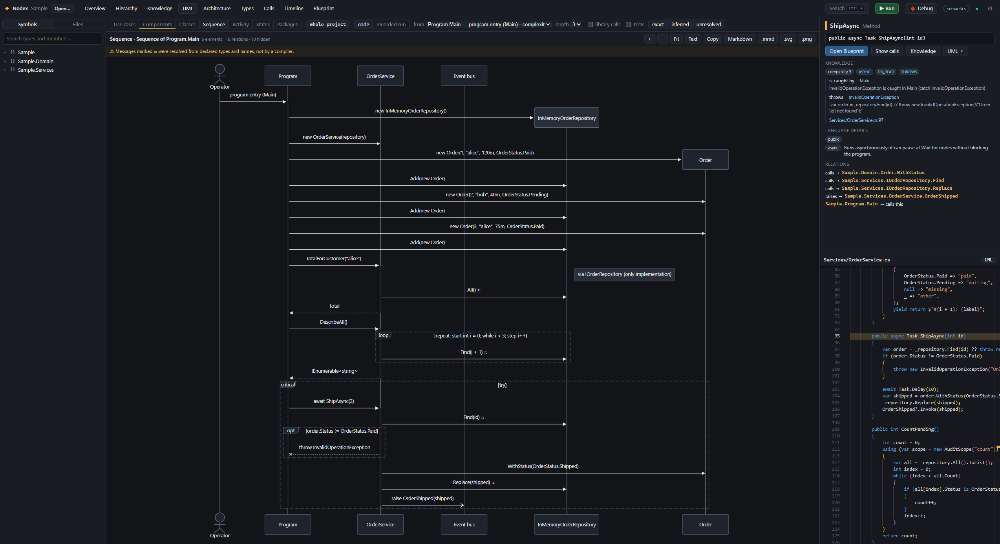

# Nodex guide

A tour of what Nodex shows and how to use it. For installing, see the [README](../README.md).

## Opening a project

Open a folder from the welcome screen, File → Open Folder… (Ctrl+O), File → Open Recent, by dropping it on the window, or with "Open with Nodex" on a folder in Explorer. Nodex recognises:

- a .NET solution or project, or a Unity project (C#);
- a folder with `package.json` or `tsconfig.json` (TypeScript and JavaScript);
- a Cargo package or workspace (Rust).

Any other folder opens too: Nodex reads every supported file in it. It skips build output and dependencies (`bin`, `obj`, `node_modules`, `target`, Unity's `Library` and so on).

Nodex shows the structure and the graphs straight away, from the syntax. When the language's toolchain is installed, it also runs that language's compiler in the background. The badge at the top right then changes from **analyzing…** to **semantics**, and calls, types and events become exact. **syntax only** means a toolchain is missing; click the badge to see which one, and where to get it.

Press **Ctrl+K** (or `/`) anywhere to search symbols and views.

## Views

- **Overview**: what the project is.
  - Entry points: the program, HTTP routes, commands, jobs, message consumers and UI.
  - Hotspots: the functions with the most decisions (cyclomatic complexity).
  - Data models, declared state machines, and the project's relations by kind.
  - Double-click a hotspot to open its Blueprint.
- **Hierarchy**: folders and namespaces, modules, types and members as boxes that open in place. Relations roll up onto the boxes you can see.
- **Knowledge**: the relations no single file shows, around one symbol or for the whole project.
  - HTTP calls from front-end code to back-end routes.
  - Dependency injection: registrations and constructor injection.
  - Tests, thrown and caught exceptions, and data writes.
  - Relations no compiler proves are drawn dashed (inferred) or dotted red (unresolved).
- **UML**: the seven UML diagrams of the project, a folder, a file, a symbol or the selected code. See [UML diagrams](#uml-diagrams).
- **Architecture**: namespaces, imported namespaces and packages.
- **Types**: classes, interfaces and records, with *extends*, *implements*, *uses* and *creates* edges.
- **Calls**: the callers and callees of a function, including the events it raises and who handles them. It needs the language's semantics.
- **Timeline**: after a run, every function call as a bar over time (a flame chart). Double-click one to replay it.
- **Blueprint**: the statements of one function as nodes. See [Blueprints](#blueprints).

## Blueprints

A Blueprint draws one function the same way whatever its language. A C# `foreach`, a TypeScript `for..of` and a Rust `for x in iter` are all one **For Each** node.

- **Exec wires** (white) give the order statements run in.
- **Data wires** (coloured) show where a variable is created and where it is used.
- Each node is labelled in plain language.
- The **Inspector** explains the concept behind the selected node, and what each language calls it.
- The code and the graph stay in sync: click code to find its node, and click a node to see its code.
- **Statements**, **Operations** and **Everything** set how much of each expression is drawn.

Open a Blueprint by double-clicking a member, from the Inspector, or from the search (Ctrl+K).

## UML diagrams

Right-click a folder, a file, a symbol or a Hierarchy box, use the Inspector or the search, or press Ctrl+Shift+U in the code.

- **Class**: members with UML visibility, inheritance and realization, associations with multiplicities, composition and aggregation, entities and their keys, and controllers and DI services as stereotypes.
- **Package**: coupling metrics and dependency cycles.
- **Component**: the HTTP calls between front end and back end, provided interfaces, databases, caches and external APIs.
- **Activity**: how a function runs.
  - Decisions, loops with their way back, try/catch and fork/join.
  - The HTTP requests and data changes it makes.
  - Calls expanded in place on demand.
- **Sequence**: a function's calls followed through other types and modules.
  - Across HTTP from front end to back end, through dependency injection to the implementation, and down to the database.
  - alt, opt, loop, par and critical fragments.
- **State**: from declared machines (XState, Stateless, Unity Animator) and from the code.
  - Enum, literal and flag fields.
  - A stored entity's status changed by services.
  - React `useState`, the State pattern, a local driving a loop, and Rust type-states.
- **Use case**: the entry points by component, with their actors (roles from `[Authorize]`, `@Roles` or `requireRole`, visitors, operators, schedulers, brokers), «include» and «extend».

Click an element to see why it is drawn. Copy the Mermaid text or a Markdown block, or save the diagram as `.mmd`, `.svg` or `.png`.

## Run, traces and debugging

**▶ Run** builds an instrumented copy of the program and runs it. Your files are never changed. While it runs:

- nodes count their executions, show the values they produce and glow;
- the Timeline records every call;
- **Replay** walks through a function step by step;
- after a run, activity and sequence diagrams mark what ran, and a sequence diagram can draw the recorded calls of any call picked in the Timeline.

Run supports:

- .NET programs (needs the .NET SDK);
- Node programs and browser apps with a dev server (needs Node.js and the project's own packages);
- Rust binaries (needs Cargo);
- Unity Play Mode (needs the Nodex package in the project; the Unity card installs it).

**Debug** starts the language's debugger. Set breakpoints in the code panel, then use F5 to continue, F10 to step over, F11 to step in, Shift+F11 to step out and Shift+F5 to stop. The first time, Nodex offers to download the debug adapter. Downloads are checked against a pinned hash.

## Settings, updates and data

- **Settings** (⚙, or File → Settings…): turn the update check at start-up on or off, or check now.
- **Updates**: when a new version is out, Nodex asks before installing it, then restarts. Updates are signed.
- **Logs**: Help → Open Logs Folder. Attach the latest log to a bug report.
- **Third-party software**: Help → Third-Party Licenses.
- **Where Nodex keeps its data**:
  - `%APPDATA%\io.github.legustavinho.nodex`: settings and recent folders.
  - `%LOCALAPPDATA%\io.github.legustavinho.nodex`: logs, debug adapters and copies of the samples.
  - A `.nodex` folder in each project: saved layouts, breakpoints and run output. Add it to `.gitignore`.

  Uninstalling with "Delete the application data" removes the first two.

## Troubleshooting

| Symptom | What to do |
| :--- | :--- |
| The badge says **syntax only** | Click it: the Environment dialog names the missing toolchain and links to it. Open the folder again after installing it. |
| ▶ Run fails | The console under the graph shows the build output. The program must build with its own toolchain first. |
| Windows warns that it "protected your PC" on install | The installer is not code-signed yet. Choose **More info → Run anyway**. |
| Anything else | Help → Open Logs Folder, and open an issue with the latest log. |
